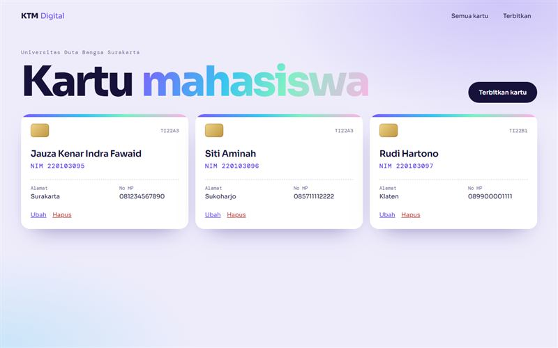

# KTM Digital

Data mahasiswa yang tampil sebagai kartu tanda mahasiswa, dengan Laravel 10.

**Demo:** https://portofolio-jauza-fawaid.netlify.app/DATA-MAHASISWA-KARTU/mahasiswa.html (pratinjau statis dengan data contoh)



## Fitur

- Tampilan data sebagai kartu mahasiswa
- Tambah, ubah, dan hapus data
- Migrasi tabel disertakan
- 4 uji otomatis untuk alur CRUD

## Menjalankan

```bash
composer install
cp .env.example .env
php artisan key:generate
php artisan migrate
php artisan serve
```

## Pengujian

```bash
php artisan test
```

## Teknologi

Laravel 10, Blade, MySQL
